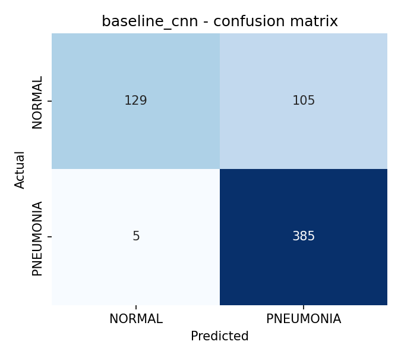
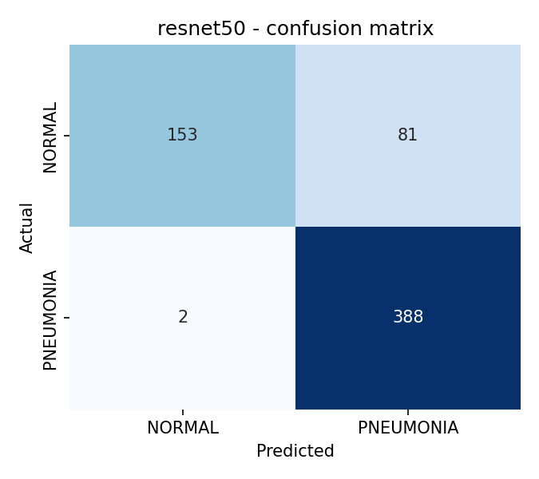
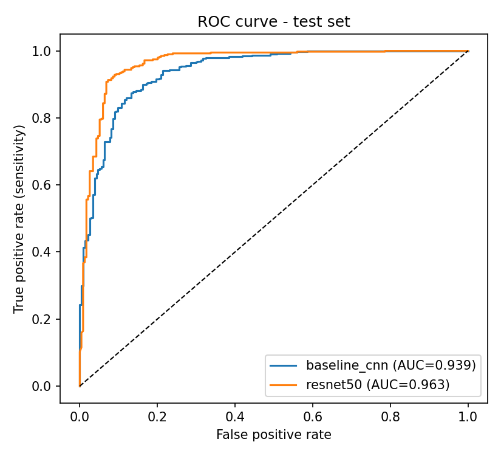
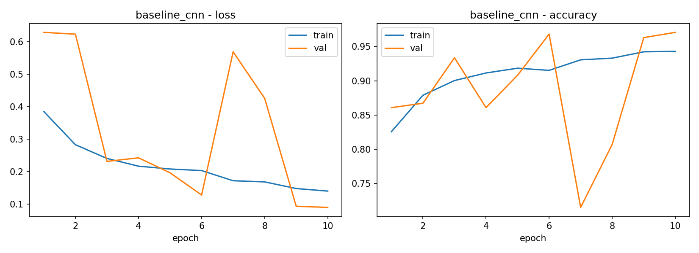
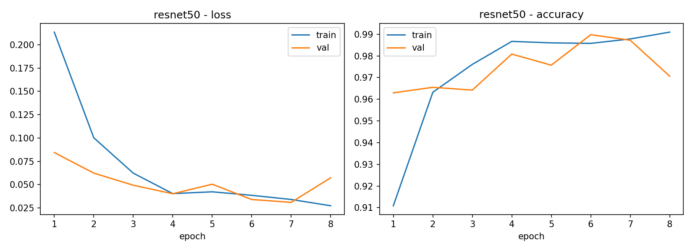
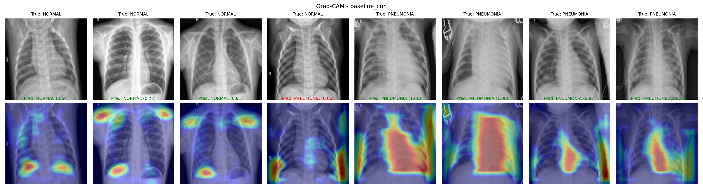
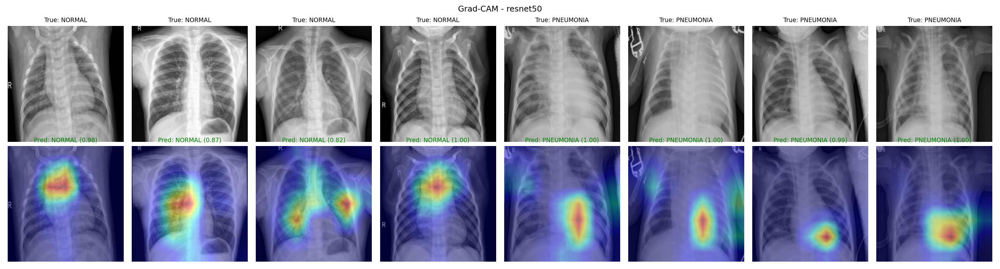

# Pneumonia Detection from Chest X-rays using Deep Learning

Binary classification of chest X-rays (**NORMAL** vs **PNEUMONIA**). The project compares a
custom CNN trained from scratch against a fine-tuned **ResNet50** (transfer learning), and uses
**Grad-CAM** to show which lung regions drove each prediction.

## Project structure

```
pneumonia-detection/
├── configs/
│   └── config.yaml          # all hyperparameters and paths
├── src/
│   ├── data.py              # loading, augmentation, stratified split, class weights
│   ├── models.py            # BaselineCNN + ResNet50 (partial fine-tuning)
│   ├── train.py             # training loop, early stopping, LR scheduling, curves
│   ├── evaluate.py          # test metrics, confusion matrices, ROC curves
│   ├── gradcam.py           # Grad-CAM implementation + visualisation
│   ├── predict.py           # single-image CLI prediction
│   └── utils.py             # config, seeding, device
├── app/
│   └── app.py               # Gradio web demo (prediction + heatmap)
├── notebooks/
│   └── colab_run.ipynb      # runs the whole pipeline on Google Colab
├── docs/
│   └── Pneumonia_Detection_Presentation.pptx
├── scripts/
│   ├── download_data.sh     # fetches dataset from Kaggle
│   └── run_all.sh           # train → evaluate → Grad-CAM
├── data/                    # dataset goes here (not committed)
├── outputs/
│   ├── checkpoints/         # best model weights (.pt, not committed: too large)
│   ├── figures/             # curves, confusion matrices, ROC, Grad-CAM
│   └── metrics/             # JSON per model + comparison.csv
├── requirements.txt
└── README.md
```

## Pipeline

```
 Chest X-ray ─► Preprocess (grayscale→3ch, 224×224, normalise)
            ─► Augment (rotate ±10°, shift, zoom, brightness/contrast)   [train only]
            ─► Model:  BaselineCNN (from scratch)  |  ResNet50 (ImageNet, layer3-4 fine-tuned)
            ─► Weighted cross-entropy (handles 1:3 class imbalance)
            ─► AdamW + ReduceLROnPlateau + early stopping on val loss
            ─► Test metrics: accuracy, precision, recall, specificity, F1, ROC-AUC
            ─► Grad-CAM heatmaps (explainability)
```

## Dataset

[Chest X-Ray Images (Pneumonia)](https://www.kaggle.com/datasets/paultimothymooney/chest-xray-pneumonia),
Kermany et al., *Cell* 2018. 5,856 paediatric X-rays from Guangzhou Women and Children's Medical Center.

| Split | NORMAL | PNEUMONIA |
|-------|--------|-----------|
| train | 1,341  | 3,875     |
| test  | 234    | 390       |

The official validation folder has only 16 images, so we create a **stratified 85/15 split of
the training set** for validation. The official test set is never used for training or model selection.

## How to run

### Option A: Google Colab (recommended, free GPU)
1. Zip this folder as `pneumonia-detection.zip`.
2. Open `notebooks/colab_run.ipynb` in Colab and set **Runtime → T4 GPU**.
3. Run all cells. You'll be asked to upload the zip and your `kaggle.json`.

### Option B: Local
```bash
pip install -r requirements.txt
bash scripts/download_data.sh     # needs ~/.kaggle/kaggle.json
bash scripts/run_all.sh           # train + evaluate + Grad-CAM
python -m src.predict path/to/xray.jpeg
python -m app.app                 # web demo
```

## Key design decisions
- **Transfer learning:** ImageNet features generalise well to X-rays; freezing early layers prevents overfitting on ~4.4k training images.
- **Class weighting:** PNEUMONIA outnumbers NORMAL ~3:1; inverse-frequency weights stop the model from biasing toward the majority class.
- **No horizontal flips:** chest X-rays are anatomically asymmetric (heart on the left).
- **Recall (sensitivity) is the priority metric:** a missed pneumonia case (false negative) is costlier than a false alarm.

## Results

Evaluated on the held-out test set (624 images: 234 NORMAL, 390 PNEUMONIA).

| Model | Accuracy | Precision | Recall | Specificity | F1 | ROC-AUC |
|-------|----------|-----------|--------|-------------|----|---------|
| Baseline CNN | 82.4% | 0.786 | 0.987 | 0.551 | 0.875 | 0.939 |
| **ResNet50 (fine-tuned)** | **86.7%** | **0.827** | **0.995** | **0.654** | **0.903** | **0.963** |

- Transfer learning improves every metric (+4.3 pts accuracy).
- ResNet50 misses only **2 of 390** pneumonia cases (99.5% recall), down from 5 for the baseline.
- False alarms drop from 105 to 81.

| | Parameters | Epochs | Training time (T4) |
|---|---|---|---|
| Baseline CNN | 1.21 M | 10 | 21.1 min |
| ResNet50 | 23.5 M (22.1 M fine-tuned) | 8 (early stopped) | 16.8 min |

### Confusion matrices and ROC

<p>
  
  
  
</p>

### Training curves

 

The baseline's validation loss is unstable (it jumps at epoch 7), while ResNet50 converges smoothly to ~99% validation accuracy.

### Grad-CAM

**Baseline CNN:** for normal X-rays it often attends to the collar bones and diaphragm edges rather than the lungs (shortcut learning).


**ResNet50:** attention falls inside the chest cavity, on the lung fields; all 8 samples are classified correctly.


## Limitations
- Paediatric patients from a single hospital, so it may not generalise to adults or other scanners.
- Binary only: doesn't distinguish bacterial vs. viral pneumonia.
- Validation accuracy (97–99%) is higher than test accuracy (87%), which suggests a distribution shift between the training and test images.
- Not clinically validated. **For academic purposes only.**

## Future work
Multi-class (bacterial/viral/normal), external-dataset validation (e.g. NIH ChestX-ray14),
threshold tuning for higher sensitivity, and model ensembling.

## Author
**Harshita Chokhani** · Registration No. 2430010505
